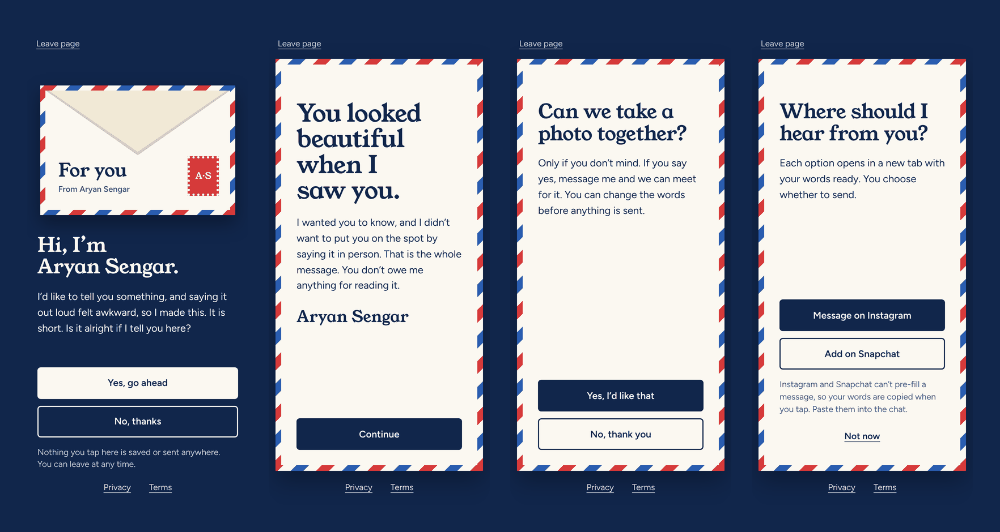

<div align="center">

<!-- ╔══════════════════════════════════════════════════════════════╗ -->
<!--                   ANIMATED WAVE HEADER                         -->
<!-- ╚══════════════════════════════════════════════════════════════╝ -->


<!-- ╔══════════════════════════════════════════════════════════════╗ -->
<!--                  ANIMATED TYPING TAGLINE                       -->
<!-- ╚══════════════════════════════════════════════════════════════╝ -->


<br/>

<!-- ╔══════════════════════════════════════════════════════════════╗ -->
<!--                      CTA BUTTONS                               -->
<!-- ╚══════════════════════════════════════════════════════════════╝ -->

[](https://note-4-you.netlify.app/)
[](https://aryan-sengar-portfolio-v2.netlify.app/)

<br/>

<!-- ╔══════════════════════════════════════════════════════════════╗ -->
<!--               ANIMATED SKILL / TECH ICON BADGES                -->
<!-- ╚══════════════════════════════════════════════════════════════╝ -->


<br/><br/>


</div>

<br/>

<!-- ━━━━━━━━━━━━━━━━━━━━━━━━━━━━ WAVE DIVIDER ━━━━━━━━━━━━━━━━━━━━━━━━━━━━ -->


<br/>

<!-- ╔══════════════════════════════════════════════════════════════╗ -->
<!--                      SITE PREVIEW                              -->
<!-- ╚══════════════════════════════════════════════════════════════╝ -->

<div align="center">

[](https://note-4-you.netlify.app/)

*Left to right: the sealed envelope, the message, the photo question, and the reply options ↑*

</div>

<br/>

<!-- ━━━━━━━━━━━━━━━━━━━━━━━━━━━━ WAVE DIVIDER ━━━━━━━━━━━━━━━━━━━━━━━━━━━━ -->


<br/>

<!-- ╔══════════════════════════════════════════════════════════════╗ -->
<!--                     ABOUT THE PROJECT                          -->
<!-- ╚══════════════════════════════════════════════════════════════╝ -->

## 💌 About The Project

**Note For You** is a small, private web page for saying something kind to someone when saying it out loud feels awkward. It is built with plain **HTML**, **CSS** and **JavaScript**, with no frameworks and no build step.

The page is meant to be opened from a **QR code**. It starts as a sealed airmail envelope and asks one question first: *is it alright if I tell you here?* Only if the answer is yes does the envelope open and the message appear. The reader can then choose to reply, or simply leave. Nothing is stored, nothing is tracked, and every screen has a way out.

> 🤝 Built around one idea: the other person is always in control. Ask first, keep Yes and No equal, and never make leaving feel like a decision.

<br/>

<div align="center">

| 🎨 Design | ⚡ Motion | 📱 Mobile First | 🔒 Privacy |
|:---:|:---:|:---:|:---:|
| Airmail envelope, cream paper, night blue | One envelope-opening moment, nothing else | Designed for phones, tested on laptops | No cookies, no analytics, no outside requests |

</div>

<br/>

<!-- ━━━━━━━━━━━━━━━━━━━━━━━━━━━━ WAVE DIVIDER ━━━━━━━━━━━━━━━━━━━━━━━━━━━━ -->


<br/>

<!-- ╔══════════════════════════════════════════════════════════════╗ -->
<!--                        FEATURES                                -->
<!-- ╚══════════════════════════════════════════════════════════════╝ -->

## ✨ Features

<br/>

| 🎨 UI & Design | ⚙️ Functionality | 📱 UX & Responsiveness |
|:---|:---|:---|
| Airmail envelope with striped border, stamp and address | Consent-first flow: asks before showing anything | Mobile-first layout, checked at 360, 390 and 1440 px |
| **Young Serif** + **Figtree**, self-hosted | Envelope flap opens and the letter slides out | 56 px tall tap targets |
| Night blue, cream, red and blue palette | Message appears in short beats so it reads in order | "Leave page" link on every screen |
| Plain rectangular buttons, no gimmicks | Photo request with equal-weight Yes and No | Respects the reduced-motion setting |
| Yes and No buttons are the same size | Pre-written reply the reader can edit before sending | Visible keyboard focus, focus moves to each new heading |
| Strong text contrast (about 14:1) | WhatsApp and email open with the words filled in | Safe-area padding for notched phones |
| Favicon and Apple touch icon included | Instagram and Snapchat get the words copied for pasting | Envelope and screen animations use only transform and opacity |
| Privacy and Terms pages included | Contact options appear only if you fill them in | Short-phone layout keeps buttons on screen |
| No images, no icon fonts | Works from a QR code or a plain link | Loads only files from its own folder |
| Edit all wording in one file | Strict Content Security Policy and no-referrer headers | Fast first load, about 60 KB zipped |

<br/>

### 📌 The Flow

```
Sealed envelope  ("Is it alright if I tell you here?")
   │
   ├── No  ──▶ Polite goodbye (can be undone)
   │
   └── Yes ──▶ Envelope opens ──▶ The message
                                      │
                          "Can we take a photo together?"
                                      │
                                      ├── No  ──▶ Thank you, done
                                      │
                                      └── Yes ──▶ Instagram / Snapchat
                                                  (reply already written)
```

<br/>

<!-- ━━━━━━━━━━━━━━━━━━━━━━━━━━━━ WAVE DIVIDER ━━━━━━━━━━━━━━━━━━━━━━━━━━━━ -->


<br/>

<!-- ╔══════════════════════════════════════════════════════════════╗ -->
<!--                        TECH STACK                              -->
<!-- ╚══════════════════════════════════════════════════════════════╝ -->

## 🛠️ Tech Stack

<br/>

<div align="center">


<br/><br/>

| Layer | Technology | Purpose |
|:---:|:---|:---|
| 🧱 **Markup** | HTML5 | Semantic structure, one section per step |
| 🎨 **Styling** | CSS3 | Custom properties, container query units, `clip-path`, 3D transforms |
| ⚡ **Logic** | Vanilla JavaScript | Step flow, config handling, clipboard, no libraries |
| 🔤 **Fonts** | [Young Serif](https://fontsource.org/fonts/young-serif) + [Figtree](https://fontsource.org/fonts/figtree) via [Fontsource](https://fontsource.org/) | Self-hosted `woff2`, no request to Google |
| 🛡️ **Security** | `_headers` file | CSP, `no-referrer`, no framing, `nosniff` |
| 🧪 **Testing** | Playwright | Screenshots at three sizes and a full-flow check |
| 🚀 **Deployment** | [Netlify](https://www.netlify.com/) | Static hosting |

</div>

<br/>

<!-- ━━━━━━━━━━━━━━━━━━━━━━━━━━━━ WAVE DIVIDER ━━━━━━━━━━━━━━━━━━━━━━━━━━━━ -->


<br/>

<!-- ╔══════════════════════════════════════════════════════════════╗ -->
<!--                     PROJECT STRUCTURE                          -->
<!-- ╚══════════════════════════════════════════════════════════════╝ -->

## 📁 Project Structure

```
Note-4-You/
│
├── 📄 index.html                    ← The note: envelope, message, photo question, contact
├── 🎨 style.css                     ← All styles, envelope animation, responsive rules
├── 🧠 app.js                        ← Step flow, contact buttons, clipboard
├── ⚙️  config.js                    ← Your handles, wording and reply text (edit this)
├── 🔒 privacy.html                  ← Privacy page
├── 📜 terms.html                    ← Terms page
├── 🔗 legal.js                      ← Adds your contact line to the legal pages
├── 🛡️  _headers                     ← Netlify security headers
├── 🖼️  favicon.svg                  ← Browser tab icon
├── 🖼️  favicon-32.png               ← Fallback tab icon
├── 🖼️  apple-touch-icon.png         ← Home screen icon
│
├── 📂 fonts/
│   ├── young-serif-latin-400.woff2  ← Headings
│   └── figtree-latin-wght.woff2     ← Body text
│
└── 📂 assets_readme/
    └── hero.png                     ← Preview image used in this README
```

<br/>

<!-- ━━━━━━━━━━━━━━━━━━━━━━━━━━━━ WAVE DIVIDER ━━━━━━━━━━━━━━━━━━━━━━━━━━━━ -->


<br/>

<!-- ╔══════════════════════════════════════════════════════════════╗ -->
<!--                      GETTING STARTED                           -->
<!-- ╚══════════════════════════════════════════════════════════════╝ -->

## 🚀 Getting Started

**1. Clone the repository**

```bash
git clone https://github.com/aryansengar007/Note-4-You.git
```

**2. Navigate into the project folder**

```bash
cd Note-4-You
```

**3. Start a local server**

```bash
python3 -m http.server 8000
```

**4. Open the page**

```
http://localhost:8000
```

> ✅ There is no build step and nothing to install. Any static file server works, for example `npx serve`.

**5. Deploy**

Drag the folder onto Netlify, or connect this repository. The `_headers` file is picked up automatically.

<br/>

### ⚙️ Configuration

Everything you may want to change is in `config.js`. You never need to edit `app.js`.

| Setting | What it does |
|:---|:---|
| `instagram` | Instagram username without the `@` |
| `snapchat` | Snapchat username |
| `whatsapp` | Number with country code, digits only. Empty means no button |
| `email` | Email address. Empty means no button |
| `message` | Title, body paragraphs and signature of the letter |
| `replies.photo` | Words pre-filled when the reader says yes to the photo |
| `exitUrl` | Where the "Leave page" link goes |

> 💡 A contact option appears only when it is filled in. If none are filled in, the page skips the reply steps and ends politely.

<br/>

<!-- ━━━━━━━━━━━━━━━━━━━━━━━━━━━━ WAVE DIVIDER ━━━━━━━━━━━━━━━━━━━━━━━━━━━━ -->


<br/>

<!-- ╔══════════════════════════════════════════════════════════════╗ -->
<!--                   DESIGN CHALLENGES                            -->
<!-- ╚══════════════════════════════════════════════════════════════╝ -->

## 🧩 Design Challenges & What I Learned

| 🐛 Challenge | ✅ Resolution |
|:---|:---|
| Striped border showed notched corners when drawn with `border-image` | Replaced it with padding over a striped background, with the paper layer on top |
| Envelope flap looked striped and drew over the letter | Rebuilt it as two clipped triangles with hidden back faces, and swapped `z-index` halfway through the flip |
| Envelope text clipped on narrow screens | Sized it with container query units (`cqw`) so it scales with the envelope, with `rem` fallbacks |
| Buttons fell below the fold on short phones | Added `max-height` rules that shrink the envelope and tighten spacing |
| Entrance animation ran twice on the intro screen | Scoped the selectors to `.scene.enter` and `.note.enter` |
| Instagram and Snapchat cannot pre-fill a message | Copy the reply to the clipboard on tap and tell the reader to paste it, while WhatsApp and email use pre-filled links |
| Stray taps during the opening animation | Added a busy flag, and reduced-motion users skip straight to the message |

> 💡 **Key takeaway:** A page about a sensitive moment is mostly about restraint. The hardest choices were what to leave out: no tracking, no pressure wording, no extra animation, and no way to make leaving feel hard.

<br/>

<!-- ━━━━━━━━━━━━━━━━━━━━━━━━━━━━ WAVE DIVIDER ━━━━━━━━━━━━━━━━━━━━━━━━━━━━ -->


<br/>

<!-- ╔══════════════════════════════════════════════════════════════╗ -->
<!--                    ACKNOWLEDGEMENTS                            -->
<!-- ╚══════════════════════════════════════════════════════════════╝ -->

## 🙌 Acknowledgements

- 🔤 Typography by [Young Serif](https://fontsource.org/fonts/young-serif) and [Figtree](https://fontsource.org/fonts/figtree), packaged by [Fontsource](https://fontsource.org/) under the SIL Open Font License
- 🧪 Browser testing with [Playwright](https://playwright.dev/)

<br/>

<!-- ╔══════════════════════════════════════════════════════════════╗ -->
<!--                     AUTHOR & CONNECT                           -->
<!-- ╚══════════════════════════════════════════════════════════════╝ -->

## 👨‍💻 Author

<div align="center">

### Aryan Sengar

🎓 **B.Tech CSE (AI & ML)** &nbsp;|&nbsp; 🌍 Gurugram, India &nbsp;|&nbsp; Frontend Developer & UI Enthusiast

<br/>

[](https://www.linkedin.com/in/aryan-sengar-786b96290/)
[](https://github.com/aryansengar007)
[](https://aryan-sengar-portfolio-v2.netlify.app/)
[](https://leetcode.com/u/aryan_sengar007/)

</div>

<br/>

<!-- ╔══════════════════════════════════════════════════════════════╗ -->
<!--                   ANIMATED WAVE FOOTER                         -->
<!-- ╚══════════════════════════════════════════════════════════════╝ -->


<div align="center">

© 2026 **Aryan Sengar** | All Rights Reserved. Unauthorized copying is strictly prohibited.

<br/>

*If you found this project helpful or inspiring, consider leaving a* ⭐ *because it means a lot!*

</div>
